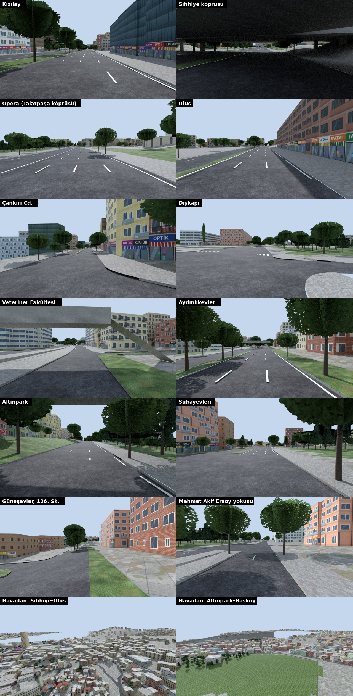

# Hat 408 — Kızılay → Güneşevler (gerçek coğrafya)



EGO 408'in (Gülpınar–Güneşevler–Kızılay–Atakule–Birlik) Kızılay → Güneşevler bölümü: **8,93 km, 18 durak**, rakım 855 m (Sıhhiye) –
964 m (Güneşevler). Plan, kaynaklar ve kararlar: `docs/PLAN_HAT3_408.md`. Hat 2 (Kızılay → Ulus) aynı haritanın ilk dört durağıdır.

Güzergâh: Atatürk Bulvarı (Kızılay, Sıhhiye köprüsünün altından, Opera'da Talatpaşa köprüsü altından) → Ulus Meydanı (Zafer Anıtı) →
Çankırı Caddesi → Dışkapı (köprü, altından Etlik Cd.) → Şehit Ömer Halisdemir Bulvarı (Veteriner Fak., Aydınlıkevler'de Turgut Özal 2
Blv. altından, Altınpark, Subayevleri) → Hasköy'de sağa Malazgirt Caddesi → 126. Sokak → Çiçek Taksi → Mehmet Akif Ersoy Caddesi
yokuşu → Güneşevler son durak.

## Üretim

```
PY=<Blender bpy'li python; numpy, scipy, shapely, mapbox_earcut, pillow> tools/harita/hat3_uret.sh
```

| Aşama | Modül | Çıktı |
|---|---|---|
| Veri | `osm_indir.sh`, `osm_birlestir.py`, `hat408_guzergah.py`, `dem.py` | `tools/harita/veri/` |
| A1 arazi | `hat3/arazi.py` | DEM 10 m (Gauss 20 m) + yol ağı kotları (graf Laplace; köprü/alt geçit) |
| A2 yollar | `hat3/yollar.py`, `hat3/yuzeyler.py` | asfalt, kaldırım (Ankara kilit taşı), refüj, bordür, şerit çizgileri, 112 yaya geçidi, köprü/alt geçit, arazi |
| A3 binalar | `hat3/dokular.py`, `hat3/binalar.py` | 4 453 OSM binası: 2 435 ayrıntılı (8 Ankara cephe stili, Türkçe tabelalı dükkânlar), LOD1, çarpışma; 29 cami + 33 minare |
| A4 simgeler | `hat3/simgeler.py` | Emek İşhanı, Kızılay AVM, Güvenlik Anıtı, Zafer Anıtı, Hitit, Opera (gerçek yerlerinde), Atatürk Anıtı (Kızılay), 62 su yüzeyi, Kale surları, metro girişleri, 7 yaya üst geçidi |
| A5 ufuk | `hat3/ufuk.py` | 2 km uzak şehir halkası: 11 499 OSM + 4 898 prosedürel blok, DEM arazisi |
| A6 donatı | `hat3/agaclar.py`, `hat3/yerlesim.py` | 6 114 ağaç, 250 lamba, 18 durak sundurması, 10 ışıklı kavşak (çapraz trafikli) |
| A7 Unity | `tools/blender/harita_hat3.py` → `Maps/Hat3/Parcalar/*.fbx` (352), `Maps/Hat3/Hat3_Yerlesim.json`, `Hat3_Harita.png` | **Ankara Bus → Hat 3 Sahnesini Kur** |

Parçalar 250 m kare (uzak halka 1 km). Unity'de `Hat3Parcalari` grupları kurar (Yol, Zemin, Binalar, Agaclar, SimgeYapilar, Ufuk),
`ParcaAkisi` otobüse uzak parçaları kapatır (Düşük 450 / Normal 650 / Yüksek 900 m), binalar parça başına LOD0/LOD1. Işık bake'i
yok (9 km), güneş gerçek zamanlı.

## Üçgen bütçesi (tüm harita)

| Katman | Üçgen |
|---|---|
| Yol (asfalt, kaldırım, refüj, bordür, çizgi) | ~590 k |
| Arazi | ~166 k |
| Binalar LOD0 / LOD1 / uzak / çarpışma | 882 k / 83 k / 78 k / 25 k |
| Ağaçlar | 302 k |
| Uzak halka | 255 k |

Görünen yarıçapta (Normal 650 m) yaklaşık 1/8'i; ölçüm yerelde (A8).

## Bilinen eksikler

- Güneşevler ucundaki 6 durak OSM'de numarasız: adresten yaklaşık (plan ✱). Sıhhiye kuzey yönü durağı da yaklaşık.
- Bina yükseklikleri OSM'de %6 binada var; geri kalanı bölge kuralı.
- Gece bina pencereleri yanmıyor; sokak lambaları parlama küresi (HavaVeZaman).
- Yaya geçitlerinde yaya trafiği yok (YayaGecitleri Hat 2/3'te kapalı; geçitler OSM'den çizili).
